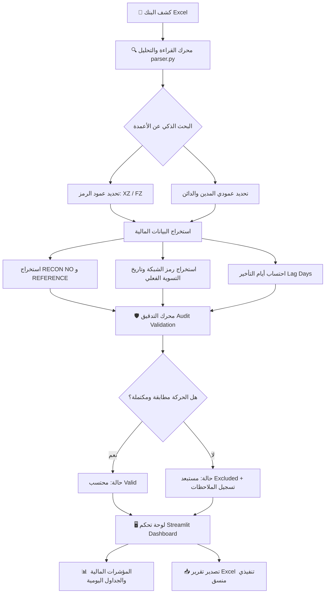

# 💳 نظام تدقيق وتسوية مبيعات نقاط البيع (POS Settlement & Audit System)

<div align="center">


**أداة برمجية مالية ذكية ومحلية بالكامل لمعالجة وتدقيق كشوفات الحسابات البنكية ومطابقة تسويات أجهزة نقاط البيع (POS) واستخراج الإيداعات والرسوم البنكية وتصدير تقارير تنفيذية متقدمة.**

[المميزات](#-المميزات-الرئيسية) • [طريقة التثبيت والتشغيل](#-طريقة-التثبيت-والتشغيل) • [هيكلية المشروع](#-هيكلية-المشروع) • [دورة حياة المعالجة](#-دورة-حياة-المعالجة-والتدقيق) • [الأمان والخصوصية](#-الأمان-والخصوصية)

</div>

---

## 📌 نبذة عن المشروع

في قطاع التجزئة والمتاجر والورش والمؤسسات، تُعد تسوية مبيعات نقاط البيع (POS) من أكثر العمليات المحاسبية استهلاكاً للوقت وعرضة للأخطاء البشرية، نظراً لتعدد الكشوفات البنكية واختلاف تواريخ التنفيذ البنكي عن تواريخ المبيعات الفعلية، بالإضافة إلى تداخل رسوم وعمولات الشبكة.

تم تصميم **نظام تسويات نقاط البيع** لحل هذه المعضلة عبر محرك تدقيق برمجي ذكي يقوم بقراءة كشف البنك مباشرة، والتعرف التلقائي على العمليات البنكية وتصنيفها، ومطابقة الإيداعات مع الرسوم، وحساب الصافي الفعلي، مع عرض لوحة تحكم تفاعلية وتوليد تقارير Excel تنفيذية متوافقة مع المتطلبات المحاسبية السعودية.

---

## ✨ المميزات الرئيسية

### 🔍 1. كشف وتحليل ذكي للكشوفات البنكية (Dynamic Header & Column Detection)
- التعرف الذكي والتلقائي على أعمدة كشف الحساب مهما اختلفت تسمياتها باللغتين العربية والإنجليزية (`Processing Date`، `Transaction Description`، `Remarks`، `Debit`، `Credit`، `Reference`...).
- فحص ذاتي ديناميكي لمحتوى الأعمدة لتحديد العمود الحامل لرموز نقاط البيع، حتى في حال عدم تطابق التسميات مع التنسيق التقليدي.
- قراءة دقيقة للتواريخ وصيغ المبالغ المالية (القيم الموجبة، والقيم السالبة مثل `-4.31`، والأرقام بين أقواس، وفواصل الآلاف).

### ⚡ 2. معالجة وتصنيف رموز نقاط البيع (POS Transaction Types)
- **رمز `XZ`**: إيداعات مبيعات نقاط البيع (Bulk Credit / POS Settlement).
- **رمز `FZ`**: خصومات رسوم وعمولات نقاط البيع (POS & E-payment Fees).
- تصفية الحركات وتجاهل المعاملات غير المرتبطة بنقاط البيع (مثل المشتريات العادية، التحويلات الداخلية، سداد الفواتير).

### 🛡️ 3. محرك تدقيق ومطابقة مالي متقدم (Financial Audit Engine)
- **استخراج رقم التسوية (`RECON NO`)**: ربط كل دفعة برقم التسوية الخاص بالجهاز.
- **استخراج المرجع البنكي (`REFERENCE`)**: لمطابقة حركة الإيداع مع حركة خصم الرسوم التابعة لها.
- **تحديد رمز الشبكة (`Network Code`)**: مثل شبكة مدى، فيزا، ماستركارد (`MD`, `VC`, `MC`, `VV`, `SM`, وغيرها).
- **تاريخ التسوية الفعلي (`Settlement Date`)**: استخراج تاريخ حركة المبيعات الفعلية (YYMMDD) من نص البيان البنكي لربطها بيوم المبيعات الحقيقي.
- **احتساب أيام التأخير (`Lag Days`)**: قياس الفارق الزمني بين تاريخ مبيعات الجهاز وتاريخ نزول المبلغ في حساب المنشأة مع التنبيه إذا كان التأخير غير اعتيادي (مثل عطل نهاية الأسبوع).
- **كشف التكرار الآلي (`Duplicate Detection`)**: تنبيه المحاسب تلقائياً في حال وجود حركات مكررة محتملة لمنع الازدواج في القيود.

### 📊 4. لوحة تحكم تفاعلية بـ Streamlit (Modern Dashboard)
- مؤشرات مالية فورية ملخصة:
  - إجمالي الإيداعات (`Total Deposits`).
  - إجمالي الخصومات والرسوم (`Total Fees`).
  - صافي الإيداعات للمقارنة (`Net POS Sales`).
  - عدّاد الحركات التي تتطلب تدقيقاً ومراجعة محاسبية.
- فلترة زمنية مرنة: تصفية حسب تاريخ التسوية (جميع الأيام أو نطاق زمني مخصص).
- عرض جدول التسويات اليومية المجمعة وجدول الحركات التفصيلية مع تلوين الحالات.

### 📑 5. تصدير تقارير Excel تنفيذية متقدمة (Automated Excel Exporter)
- توليد مصنف Excel منسق وفق الهوية المحاسبية الرسمية:
  - **ورقة التسويات اليومية**: تتضمن إجمالي الإيداعات والخصومات وصافي كل يوم (بما يشمل الأيام الخالية من المبيعات لضمان سلامة التسلسل الزمني).
  - **ورقة التسويات حسب نزول البنك**: لعقد مقارنات دورية مع الكشف المالي للبنك.
  - **ورقة تفاصيل الحركات**: جدول متكامل لجميع المعاملات مع أرقام التسوية والمراجع وملاحظات التدقيق.
  - **ورقة حركات للمراجعة**: تُنشأ تلقائياً في حال وجود أي حركة غير مطابقة أو بلا تاريخ تسوية لتسهيل مراجعتها من فريق التدقيق.
- دعم كامل للعربية من اليمين لليسار (`Right-to-Left - RTL`)، وتجميد العناوين (`Freeze Panes`)، وتفعيل الفلاتر التلقائية (`Auto-Filter`)، وتحديد عروض الأعمدة ديناميكياً لتجنب اختفاء النصوص أو ظهور رموز `###`.

---

## 🔄 دورة حياة المعالجة والتدقيق



---

## 📁 هيكلية المشروع

```text
pos_settlement_app/
│
├── README.md                 # دليل الاستخدام والتوثيق الشامل
├── .gitignore                # استثناء البيئة الافتراضية والملفات المؤقتة والبيانات البنكية
│
└── pos_app/
    ├── app.py                # الواجهة الرئيسية لتطبيق Streamlit التفاعلي
    ├── parser.py             # محرك التحليل ومعالجة وتدقيق كشوفات الحساب البنكية
    ├── exporter.py           # مولد تقارير Excel التفاعلية والتنسيقات المحاسبية المتقدمة
    ├── constants.py          # الثوابت المركزية (أنماط الأعمدة، رموز العمليات، مفاتيح التدقيق)
    ├── requirements.txt      # قائمة الاعتماديات والمكتبات المطلوبة
    ├── START.bat             # مشغّل تلقائي بنقرة واحدة لأنظمة Windows
    └── README.md             # نسخة التوثيق المرفقة داخل حزمة التطبيق
```

---

## 🚀 طريقة التثبيت والتشغيل

### الخيار 1: التشغيل بنقرة واحدة (موصى به لمستخدمي Windows)
1. تأكد من تثبيت بيئة **Python 3.10+**.
2. انقر نقراً مزدوجاً على الملف:
   ```cmd
   START.bat
   ```
   *يقوم السكربت تلقائياً باكتشاف البيئة الافتراضية، وتثبيت الحزم الناقصة، وإطلاق الواجهة عبر المتصفح مباشرة.*

---

### الخيار 2: التشغيل اليدوي عبر موجه الأوامر (Command Prompt / Terminal)

1. **الاستنساخ والدخول للمجلد**:
   ```bash
   git clone https://github.com/omar-bakhsh/pdf-invoice-to-excel.git
   cd pdf-invoice-to-excel/pos_settlement_app/pos_app
   ```

2. **إنشاء البيئة الافتراضية وتفعيلها (اختياري ولكن محبّذ)**:
   ```bash
   python -m venv .venv
   # على Windows:
   .venv\Scripts\activate
   # على Linux / macOS:
   source .venv/bin/activate
   ```

3. **تثبيت الحزم المطلوبة**:
   ```bash
   pip install -r requirements.txt
   ```

4. **تشغيل التطبيق**:
   ```bash
   streamlit run app.py
   ```

5. سيفتح التطبيق تلقائياً في المتصفح على العنوان المحلي:
   ```
   http://localhost:8501
   ```

---

## 🔒 الأمان والخصوصية (Data Privacy)

> [!IMPORTANT]
> **أمان بياناتك المالية في المقام الأول**:
> - التطبيق يعمل **محلياً بالكامل (100% On-Premise)** على جهازك الشخصي أو سيرفر منشأتك الداخلي.
> - لا يتم إرسال أي أرقام حسابات، أو كشوفات بنكية، أو بيانات مالية، أو مبالغ مبيعات إلى أي خوادم خارجية أو واجهات سحابية إطلاقاً.
> - ملفات كشوفات البنك (`*.xlsx`, `*.csv`) مستثناة تلقائياً من نظام Git لضمان عدم مشاركة أي بيانات حساسة بطريق الخطأ.

---

## 🛠️ التقنيات المستخدمة

- **[Python](https://www.python.org/)**: لغة المعالجة الأساسية.
- **[Streamlit](https://streamlit.io/)**: بناء لوحة التحكم المالية التفاعلية.
- **[Pandas](https://pandas.pydata.org/)**: معالجة البيانات، التجميعات اليومية، وتطبيق قواعد التدقيق المالي.
- **[OpenPyXL](https://openpyxl.readthedocs.io/)**: بناء مصنفات وتقارير Excel وتطبيق التنسيقات والخلايا النمطية المتقدمة.

---

## 📄 الترخيص (License)

هذا المشروع مرخص تحت رخصة **MIT**. يمكنك استخدامه وتعديله وتطويره بحرية.
